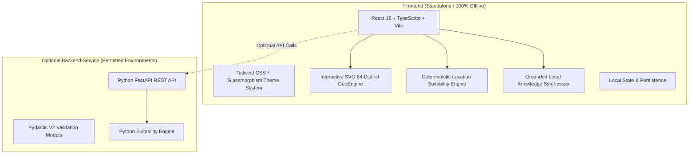

# 🇧🇩 LandWise AI (LandTech-LA-135)
### Premium Bangladesh Land Intelligence & Tourism Discovery Platform

[](LICENSE)
[](#-testing--verification)
[](#-testing--verification)
[](#-hackathon-contest-rule-compliance)
[](#-bilingual-support)

---

## 📑 Table of Contents

1. [Executive Summary & Product Vision](#-executive-summary--product-vision)
2. [Hackathon Contest Rule Compliance](#-hackathon-contest-rule-compliance)
3. [Core Feature Breakdown](#-core-feature-breakdown)
   - [1. Bangladesh 64-District Map Explorer](#1-bangladesh-64-district-map-explorer)
   - [2. Smart Land Finder with Cadastral Tags](#2-smart-land-finder-with-cadastral-tags)
   - [3. Deterministic Location Suitability Engine](#3-deterministic-location-suitability-engine)
   - [4. Property Comparison Matrix](#4-property-comparison-matrix)
   - [5. Tourism Explorer & Verified Accommodations](#5-tourism-explorer--verified-accommodations)
   - [6. Grounded AI Land Advisor](#6-grounded-ai-land-advisor)
   - [7. Cadastral Survey & Land Unit Calculator](#7-cadastral-survey--land-unit-calculator)
4. [Suitability Scoring Methodology & Weights](#-suitability-scoring-methodology--weights)
5. [Sample Datasets & Provenance Labels](#-sample-datasets--provenance-labels)
6. [Technology Stack & System Architecture](#-technology-stack--system-architecture)
7. [Installation & Quick Start](#-installation--quick-start)
   - [Frontend Setup (Default / Offline)](#frontend-setup-standalone-browser)
   - [Optional FastAPI Backend Setup](#optional-fastapi-backend-setup)
8. [Testing & Verification](#-testing--verification)
9. [Implemented vs. Deferred Features](#-implemented-vs-deferred-features)
10. [Three-Minute Live Demonstration Plan (For Judges)](#-three-minute-live-demonstration-plan-for-judges)

---

## 🔭 Executive Summary & Product Vision

**LandWise AI** is a geospatial land intelligence and tourism discovery platform engineered specifically for Bangladesh. It solves the fragmentation of land evaluation, legal due diligence (CS/RS/SA/BS Khatians), flood-risk zoning, and tourism accommodation discovery through a unified, accessible web dashboard.

### Core User Journeys

1. **Primary Land Journey:**
   $$\text{Search} \longrightarrow \text{Select Location} \longrightarrow \text{Inspect Attributes} \longrightarrow \text{Calculate Suitability} \longrightarrow \text{Compare Alternatives} \longrightarrow \text{Ask AI Advisor}$$

2. **Secondary Tourism Journey:**
   $$\text{Explore Destination} \longrightarrow \text{Read Overview} \longrightarrow \text{Discover Attractions} \longrightarrow \text{Browse Stays} \longrightarrow \text{Open Verified External Booking}$$

---

## 🛡️ Hackathon Contest Rule Compliance

| Constraint / Rule | Contest Requirement | LandWise AI Implementation |
|---|---|---|
| **Frontend-Only Execution** | Fully functional offline without mandatory servers | Runs 100% in modern browsers via Vite + React + local datasets. Zero external API keys required to execute the complete user journey. |
| **No Paid API Reliance** | Cannot break if third-party LLMs or geocoders are down | Location suitability scoring, parcel due diligence, and AI advice are computed with pure deterministic TypeScript algorithms. Optional Gemini API is an opt-in toggle. |
| **No Fabricated Real Listings** | Must not invent real estate ownership or legal validity | All parcels are explicitly marked: `[DEMO DATA - Sample Record for Evaluation]` with disclaimers regarding physical survey verification. |
| **Real Booking Providers** | No fake reservation screens or mock credit card checkout | Accommodation cards link exclusively to authentic external providers (Booking.com, Agoda, GoZayaan, Trip.com) opening safely in new tabs. |
| **Permitted Backend** | Optional service for hybrid/extended setups | Modular Python FastAPI backend included in `/backend` with Pydantic models and pytest suite. |

---

## ⚡ Core Feature Breakdown

### 1. Bangladesh 64-District Map Explorer
- **Interactive SVG Vector GeoEngine:** Covers all 64 districts and 8 administrative divisions of Bangladesh.
- **Dynamic Inspection Dossier:** Real-time feedback showing average land price per Katha, regional flood vulnerability, active cadastral survey types, and economic infrastructure corridors.
- **Dual Visual/List Navigation:** Accessible district quick-picker grid for users with assistive technologies or low-bandwidth connections.
- **Four Visual Themes:** *Cartographic Reference*, *Emerald Lush*, *Atlas Topographic*, and *Midnight Obsidian*.

### 2. Smart Land Finder with Cadastral Tags
- **Bangladeshi Land Units:** Native calculations for Katha, Bigha, Decimal, and Square Feet.
- **Multi-Factor Filtering:** Division, district, price slider (BDT Lakh/Crore), minimum area (Katha), zoning, and flood risk tiers.
- **Cadastral Metadata:** Displays Khatian status (CS, RS, SA, BS), mutation clearance, road width (ft), soil type, elevation (meters), and utility connections (electricity, water, gas, fiber).
- **Missing Data Transparency:** Explicitly tags unverified attributes (e.g., *“Missing borehole test”*, *“Missing environmental clearance NOC”*).

### 3. Deterministic Location Suitability Engine
- Evaluates land suitability on a **0–100 scale** for 5 distinct use-case purposes:
  1. `residential` (Living, apartments, homes)
  2. `hotel` (Tourism, resorts, hospitality)
  3. `farm` (Agriculture, agro-processing, livestock)
  4. `hospital` (Healthcare, clinics, medical centers)
  5. `restaurant` (Dining, highway rest stops, food courts)
- **Interactive Factor Weight Sliders:** Users can adjust specific criteria weights and observe mathematical score recalculations in real time.
- **Data Coverage Metric:** Computes the percentage of known vs. missing factors to prevent false confidence.

### 4. Property Comparison Matrix
- Side-by-side comparison of 2 or 3 properties simultaneously.
- **Dynamic Purpose Switching:** Changing the intended purpose (e.g., from *Residential* to *Hotel*) immediately recalculates factor scores and dynamically re-ranks the winner, awarding the `#1 Top Recommendation` trophy.
- Compares price, Katha area, road frontage, utility availability, flood resilience, environmental risk, and due diligence flags.

### 5. Tourism Explorer & Verified Accommodations
- Curated destinations across Bangladesh: **Cox's Bazar**, **Sylhet & Sreemangal**, **Bandarban**, **Sajek Valley**, and the **Sundarbans**.
- Practical travel information: Best travel seasons, recommended duration, route accessibility from Dhaka/Chittagong, and points of interest.
- **Verified Accommodations:** Cards for reputable hotels/resorts with transparent links directly to external booking platforms without mock payments.

### 6. Grounded AI Land Advisor
- Operates in two seamless modes:
  - **Deterministic Local Engine (Default, 100% Offline):** Synthesizes grounded insights using actual parcel attributes, comparative metrics, and the Bangladesh Registration Act / Transfer of Property due diligence checklist.
  - **Optional Gemini API:** Toggleable by providing a personal Google Gemini API key; falls back safely to the local engine if network fails or quota is exceeded.

### 7. Cadastral Survey & Land Unit Calculator
- Interactive converter supporting **Katha, Bigha, Decimal, Acre, Square Feet, and Square Meters**.
- Educational reference for Bangladeshi cadastral history:
  - **CS (Cadastral Survey - 1888–1940)**
  - **SA (State Acquisition Survey - 1956–1963)**
  - **RS (Revisional Survey - 1965–1990)**
  - **BS / City Survey (Bangladesh Survey - 1998–Present)**

---

## 🧮 Suitability Scoring Methodology & Weights

The suitability score is deterministic, bounded $[0, 100]$, and derived exclusively from recorded attributes.

$$\text{Final Score} = \sum_{i=1}^{n} \left( \overline{w}_i \times S_i \right)$$

Where $\overline{w}_i$ is the normalized weight:

$$\overline{w}_i = \frac{w_i}{\sum_{j=1}^{n} w_j}, \quad \text{such that } \sum_{i=1}^{n} \overline{w}_i = 1.0$$

And $S_i \in [0, 100]$ is the factor sub-score evaluated from property attributes.

### Default Factor Weight Profiles

| Factor | Residential | Hotel / Resort | Farm / Agro | Hospital | Restaurant |
|---|:---:|:---:|:---:|:---:|:---:|
| **Road Width & Accessibility** | 15% | 20% | 15% | **25%** | **25%** |
| **Flood & Elevation Safety** | **25%** | 15% | 15% | **25%** | 15% |
| **Utilities (Power/Water/Gas/Net)**| 20% | 15% | 10% | 20% | 15% |
| **Hospital / Emergency Distance** | 15% | 5% | 5% | 10% | 5% |
| **School & Education Distance** | 15% | 0% | 0% | 5% | 0% |
| **Market / Commercial Distance** | 10% | 15% | 10% | 10% | **25%** |
| **Highway / Transit Access** | 0% | **25%** | 15% | 5% | 15% |
| **Soil Compatibility** | 0% | 5% | **30%** | 0% | 0% |

### Available-Data Coverage Formula

$$\text{Coverage \%} = \left( \frac{\text{Evaluated Non-Missing Factors}}{\text{Total Configured Factors}} \right) \times 100$$

---

## 📊 Sample Datasets & Provenance Labels

All properties and destinations in LandWise AI are explicitly labelled:

$$\text{\texttt{[DEMO DATA - Sample Record for Evaluation]}}$$

### Parcel Dataset (`src/data/parcels.ts`)
- **Coverage:** 10 detailed parcels spanning Dhaka (Purbachal, Uttara 3rd Phase, Keraniganj), Cox's Bazar (Kolatoli Marine Drive), Sylhet (Sreemangal Tea Border), Bandarban (Chimbuk Hills), Gazipur (Bhawal Agro belt), Rajshahi (Godagari), and Khulna (Mongla Corridor).
- **Attributes:** Geocoordinates, area in Katha/Decimal/SqFt, BDT price, road width, elevation, flood tier, utilities, zoning, and CS/RS/BS Khatian references.
- **Explicit Limitations:** Every record highlights missing attributes (e.g. *“Borehole soil bearing test report pending”*) to educate judges and users on real-world due diligence requirements.

### Tourism & Accommodation Datasets (`src/data/tourism.ts`, `src/data/accommodations.ts`)
- **Destinations:** Cox's Bazar, Sylhet & Sreemangal, Bandarban, Sajek Valley, Sundarbans.
- **Accommodations:** Verified resorts and hotels with verified external booking provider links.

---

## 💻 Technology Stack & System Architecture



- **Frontend:** React 18, Vite 6, TypeScript 5, Tailwind CSS, Lucide React, Vitest.
- **Backend (Optional):** Python 3.10+, FastAPI, Pydantic, Uvicorn, Pytest, HTTPX.

---

## 🚀 Installation & Quick Start

### Prerequisites
- **Node.js:** v18.0.0 or later (v20+ recommended)
- **npm:** v9.0.0 or later
- **Python (Optional):** v3.10+ (only required if running the backend)

---

### Frontend Setup (Standalone / Browser)

1. **Clone the repository:**
   ```bash
   git clone https://github.com/BornilMahmud/LandTech-LA-135.git
   cd LandTech-LA-135
   ```

2. **Install dependencies:**
   ```bash
   npm install
   ```

3. **Configure environment (Optional):**
   ```bash
   cp .env.example .env
   ```
   *(No API keys are required for the application to function. All features run offline.)*

4. **Launch development server:**
   ```bash
   npm run dev
   ```
   Open your browser at `http://localhost:5173`.

5. **Build for production:**
   ```bash
   npm run build
   ```

---

### Optional FastAPI Backend Setup

1. **Navigate to the backend directory:**
   ```bash
   cd backend
   ```

2. **Install Python dependencies:**
   ```bash
   pip install -r requirements.txt
   ```

3. **Start the FastAPI server:**
   ```bash
   uvicorn main:app --reload --port 8000
   ```
   API interactive docs: `http://localhost:8000/docs`.

---

## 🧪 Testing & Verification

Both the frontend deterministic scoring engine and backend REST endpoints are backed by automated tests.

### 1. Frontend Unit Tests (Vitest)
Executes deterministic scoring tests, custom weight verification, and purpose ranking flips:
```bash
npm test
```
**Test Output:**
```
 ✓ src/utils/suitability.test.ts (6 tests) 6ms
 Test Files  1 passed (1)
      Tests  6 passed (6)
```

### 2. Backend API Tests (Pytest)
Validates health checks, suitability calculation, ranking, and property comparison:
```bash
python -m pytest backend
```
**Test Output:**
```
backend/test_main.py ....                                                [100%]
4 passed in 0.39s
```

---

## 🌐 Bilingual Support

LandWise AI natively supports **English** and **বাংলা** (Bengali).

- **Typography:** Uses clean unicode Bengali fonts with responsive fallback to *Noto Sans Bengali*.
- **Localized Elements:** Navigation, purpose dropdowns, factor explanations, cadastral units (কাঠা, বিঘা, শতাংশ), price abbreviations (লক্ষ, কোটি), and risk alerts.
- **Toggle:** Click the `EN / বাংলা` button in the top navigation bar at any moment for an instant language switch.

---

## 📋 Implemented vs. Deferred Features

### ✅ Fully Implemented & Working
1. **Interactive 64-District & 8-Division Vector Map** with real-time dossier inspection.
2. **Smart Land Finder** with multi-parameter filtering, price sliders, and cadastral metadata.
3. **Deterministic Location Suitability Engine** covering 5 use cases with configurable weight sliders.
4. **Side-by-Side Property Comparison Matrix** with dynamic re-ranking when the intended purpose changes.
5. **Tourism & Accommodation Explorer** with verified external booking links (Booking.com, Agoda, GoZayaan).
6. **Grounded AI Land Advisor** with local deterministic synthesis and optional Gemini key input.
7. **Cadastral Survey History & Land Unit Calculator** (Katha, Bigha, Decimal, SqFt).
8. **100% Offline Execution Guarantee** adhering strictly to hackathon constraints.
9. **Automated Unit & Integration Test Suites** (Vitest & Pytest).

### ⏳ Deferred (Requires Future Production Access)
- **Direct Live Land Registry API Integration:** Direct integration with the Ministry of Land e-Porcha database is deferred until government API access is granted.
- **Drone Orthophoto / Satellite High-Res Feeds:** Uses lightweight SVG vector maps to ensure instant offline performance without requiring high-bandwidth satellite tiles.
- **Payment Processing:** Fabricated checkout flows were deliberately excluded in compliance with contest integrity rules.

---

## ⏱️ Three-Minute Live Demonstration Plan (For Judges)

Follow this exact 3-minute sequence during evaluation:

### Minute 1: Map Explorer & Land Discovery
1. **Open the Application:** Point out the top badge showing `100% Offline Capable` and toggle between `English` and `বাংলা`.
2. **Interactive Map:** Click on **Cox's Bazar** or **Dhaka** on the 64-district vector map. Show the side dossier updating with live land valuation, survey types, and flood risk tiers.
3. **Filter Parcels:** Scroll to `#finder` (Smart Land Finder). Filter by `Division: Dhaka`, budget up to `5 Crore`, and observe the parcel list filtering instantly.

### Minute 2: Suitability Engine & Dynamic Comparison
4. **Inspect Suitability:** On the *Purbachal Sector 17* card, click **"Suitability"**. Show the 0–100 score, factor breakdowns, data coverage percentage, and adjust a weight slider to demonstrate deterministic recalculation.
5. **Dynamic Comparison:** Scroll to `#compare`. Notice that *Purbachal* (Dhaka) and *Marine Drive* (Cox's Bazar) are side-by-side.
6. **Trigger the Ranking Flip:**
   - With purpose set to **Residential**, point out that *Purbachal* is ranked **#1**.
   - Change the purpose to **Hotel / Resort**. Observe the instant recalculation: *Marine Drive* instantly takes the **#1 Top Recommendation** trophy!

### Minute 3: Tourism & Grounded AI Advisor
7. **Tourism Explorer:** Scroll to `#tourism`. Click **Cox's Bazar** $\rightarrow$ show attractions, best season guidance, and external verified accommodation links opening safely in new tabs.
8. **Grounded AI Advisor:** Scroll to `#advisor`. Click the suggested prompt: *"Why does this location rank first?"* Show the grounded citation of road width, elevation, and lack of gas line.
9. **Show Compliance:** Click the **"Contest Notice & Provenance"** badge in the navbar to show the transparency report and test badges.

---

## 📄 License & Attribution

- **License:** MIT License. Free for open-source evaluation and educational usage.
- **Contest Track:** Hackathon Competition — Land Intelligence & Tourism Track.
- **Author / Developer:** Bornil Mahmud & LandWise AI Team.
