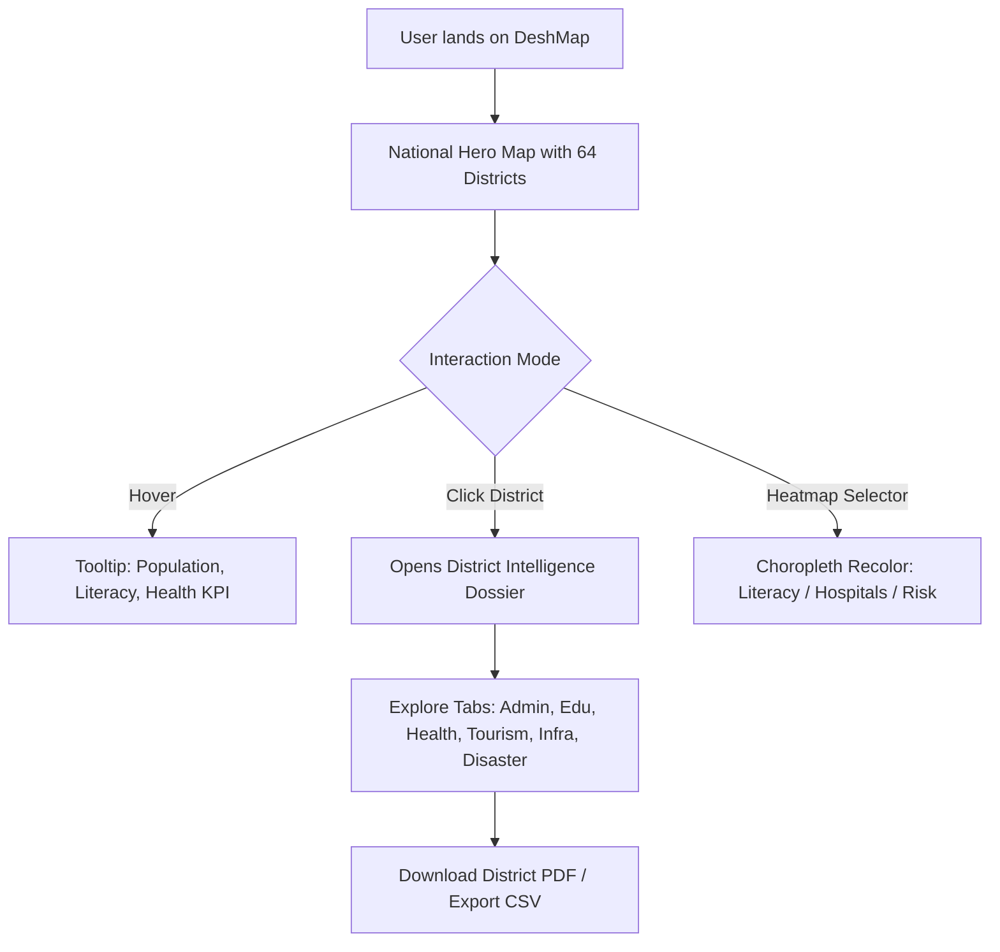
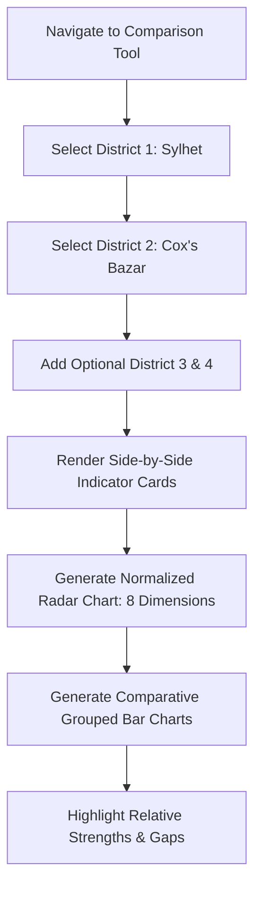
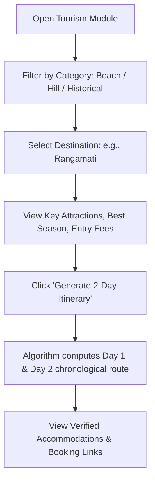
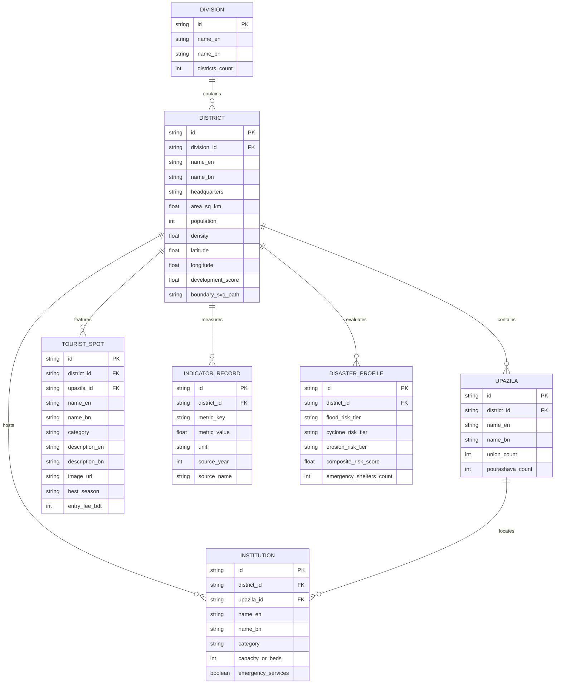

# Product Requirements Document (PRD)
## Bangladesh District Intelligence Platform — “DeshMap”

**Version:** 1.0.0 (Production / Hackathon Baseline)  
**Date:** October 12, 2026  
**Project Type:** Hackathon / MVP Web Application  
**Status:** Approved for Implementation & Release  
**Document Owner:** Product & Engineering Team  
**Corpus / Repo:** `BornilMahmud/LandTech-LA-135` (`deshmap`)  

---

## 1. Document Control & Executive Overview

### 1.1. Executive Summary
**DeshMap** is an interactive, map-driven spatial intelligence platform for Bangladesh. It consolidates fragmented socioeconomic, administrative, educational, healthcare, tourism, infrastructure, and disaster-risk datasets across all **8 administrative divisions**, **64 districts**, and **495 upazilas** into an intuitive digital atlas and dashboard.

Currently, district-level data in Bangladesh is dispersed across multiple government ministries (BBS, DGHS, BANBEIS, MoDMR), disparate statistical yearbooks, static PDF reports, and localized websites. DeshMap turns these siloed data points into a high-performance visual dashboard that empowers students, researchers, domestic travelers, policy planners, journalists, and civic citizens to explore, compare, and understand any region of Bangladesh within three clicks.

### 1.2. Product Vision & Mission
> **Vision:** Democratize spatial and district-level intelligence in Bangladesh by transforming static census and administrative records into an interactive, comparative digital atlas.
>
> **Mission:** Deliver a sub-second, bilingual (English & বাংলা), 100% offline-capable web application that enables any citizen or decision-maker to visualize regional inequalities, discover tourism assets, and evaluate climate vulnerabilities without paid API dependencies.

### 1.3. Geographic & Administrative Hierarchy
Bangladesh operates on a 4-tier geographic and administrative hierarchy modeled within DeshMap:
$$\text{National Level (1)} \longrightarrow \text{Divisions (8)} \longrightarrow \text{Districts/Zilas (64)} \longrightarrow \text{Upazilas/Thanas (494--495)} \longrightarrow \text{Unions / Pourashavas}$$

---

## 2. Problem Statement & Opportunity Gap

### 2.1. The Data Fragmentation Crisis
In Bangladesh, regional decision-making and civic discovery are crippled by:
1. **Siloed Public Data:** The Bangladesh Bureau of Statistics (BBS) maintains population and literacy censuses, the Directorate General of Health Services (DGHS) holds hospital registers, the Ministry of Education (BANBEIS) holds institutional records, and the Ministry of Disaster Management and Relief (MoDMR) tracks climate risks. There is no unified analytical interface connecting these records.
2. **Lack of Spatial Discovery:** Government portals offer static tables or PDFs lacking vector map boundaries, dynamic choropleths, or multi-metric filtering.
3. **Tourism Information Asymmetry:** Information on tourist destinations, heritage spots, and natural landmarks is scattered across ad-driven commercial blogs, often lacking verified geographic coordinates, seasonality insights, or structured itineraries.
4. **Inequity in Regional Visibility:** Secondary and tertiary districts (e.g., Meherpur, Barguna, Panchagarh, Sunamganj) suffer from severe information deficits compared to metropolitan hubs like Dhaka and Chattogram.

### 2.2. The DeshMap Solution
DeshMap introduces a unified spatial portal featuring:
- An authentic vector-based national hero map with 64 clickable district boundaries.
- Instant district dossier pages detailing administrative structures, demographics, literacy, healthcare density, economic output, and infrastructure.
- Geospatial heatmaps (choropleth maps) visualizing development scores, hospital bed density, school ratios, and disaster vulnerability.
- An interactive side-by-side district comparison matrix with radar and bar analytics.
- A curated bilingual tourism directory with categorized attractions and automated 2-day itinerary generators.
- Built-in PDF/CSV export tools for instant academic and reporting workflows.

---

## 3. Goals, Objectives & Success Metrics

### 3.1. Strategic Objectives (OKRs)

| Strategic Objective | Key Result (KR) | Target Threshold |
|---|---|---|
| **Frictionless Spatial Exploration** | Time required for a user to open any district dossier from national view | $\le 3\text{ clicks} \text{ or } < 2\text{ seconds}$ |
| **Comprehensive National Coverage** | Baseline coverage of all 64 districts with verified data | $100\%\text{ (64/64 districts verified)}$ |
| **Comparative Analytical Rigor** | Minimum indicators supported in multi-district comparison | $\ge 12\text{ standardized indicators}$ |
| **Bilingual Accessibility** | Primary UI and core geographic entities rendered in English & বাংলা | $100\%\text{ bilingual parity}$ |
| **Hackathon Execution & Reliability** | Zero runtime crashes during live judging and 100% offline fallback | $99.9\%\text{ uptime, 0 external API blockers}$ |

### 3.2. Out of Scope / Non-Goals (MVP Boundaries)
To ensure reliable delivery within a competitive hackathon timeline, the following are strictly deferred:
- ❌ **Real-Time Hospital Bed Telemetry:** Live bed occupancy requires hospital IoT/EHR integrations that do not exist at a national public scale; static registered bed counts will be utilized.
- ❌ **Government-Authenticated Ingestion Pipelines:** No live write-back or authenticated API integration into national ministry databases.
- ❌ **Native Mobile Applications:** iOS and Android native apps are deferred in favor of a 100% responsive Progressive Web App (PWA) compatible with mobile viewports down to 360px.
- ❌ **E-Commerce / Commercial Booking Checkout:** Accommodation and tour bookings will not feature internal payment gateways; verified external links (GoZayaan, Booking.com, Agoda) are utilized.
- ❌ **Heavy Geospatial Raster Processing:** No dynamic GeoTIFF raster computations on client devices; optimized vector GeoJSON / SVG boundary polygons will be used.

---

## 4. Target Personas & User Journeys

### 4.1. Personas

```
+---------------------------------------------------------------------------------------------------+
| PERSONA 1: Sultana Akhter -- Academic Researcher & Geography Student                              |
| Goal: Needs rapid demographic, institutional, and literacy metrics across northern districts.      |
| Frustration: Spending hours copying disparate numbers out of BBS statistical yearbooks and PDFs.  |
| Primary Feature: District Dossier, Choropleth Heatmaps, CSV Export.                               |
+---------------------------------------------------------------------------------------------------+
| PERSONA 2: Tanvir Hossain -- Domestic Traveler & Travel Content Creator                           |
| Goal: Wants to plan a 2-day weekend exploration in Bandarban or Moulvibazar.                      |
| Frustration: Outdated blog articles with missing road connections and unknown seasonality.        |
| Primary Feature: Tourism Explorer, Category Filter, 2-Day Itinerary Planner.                      |
+---------------------------------------------------------------------------------------------------+
| PERSONA 3: Dr. Farzana Yeasmin -- NGO Development Specialist & Public Health Planner              |
| Goal: Identify healthcare and education disparities in flood-prone haor and coastal belts.        |
| Frustration: Inability to overlay healthcare facility density against disaster exposure.          |
| Primary Feature: Multi-District Comparison Matrix, Disaster-Risk Map Layer, PDF Report Generator. |
+---------------------------------------------------------------------------------------------------+
| PERSONA 4: Arifur Rahman -- Data Journalist                                                       |
| Goal: Quickly fact-check administrative boundaries, upazila counts, and literacy comparisons.     |
| Frustration: Conflicting numbers between national portals and outdated Wikipedia pages.           |
| Primary Feature: Omnichannel Bilingual Search, Side-by-Side Radar Visualizer.                    |
+---------------------------------------------------------------------------------------------------+
| PERSONA 5: Mohammad Rafiq -- Civic Citizen / Local Community Member                               |
| Goal: Explore historical heritage, local products, and public amenities in his ancestral district.|
| Frustration: Complex GIS tools that require technical knowledge and English fluency.             |
| Primary Feature: 1-Click Interactive Map, Bangla Language Mode, Mobile-First Cards.               |
+---------------------------------------------------------------------------------------------------+
```

### 4.2. Core User Journeys

#### Journey 1: Spatial Overview to Deep District Intelligence


#### Journey 2: Multi-District Comparative Evaluation


#### Journey 3: Tourism Discovery & Itinerary Generation


---

## 5. Scope Matrix

| Capability | In-Scope (MVP v1.0) | Target (v1.5) | Out-of-Scope (v2.0+) |
|---|:---:|:---:|:---:|
| **Interactive Bangladesh Map** | 64 Districts + 8 Divisions Vector SVG | Upazila-level vector drill-down | Mouza / Dag cadastre vector tiles |
| **District Dossiers** | All 64 Districts with complete statistics | Extended Upazila profiles | Real-time sensor IoT feeds |
| **Education Module** | School, College, University, Literacy stats | School geo-coordinates mapping | Teacher-student ratio tracking |
| **Healthcare Module** | Hospitals, Clinics, Bed Density per 100k | Specialized ICU/CCU bed flags | Live emergency bed availability |
| **Tourism Explorer** | 190+ Curated Spots, Categories, Images | User reviews & photo uploads | Hotel reservation payment gateway |
| **Itinerary Generator** | Rule-based 2-Day Curated Itinerary | Custom multi-day route builder | GPS turn-by-turn navigation |
| **Choropleth Heatmaps** | 10 National Metric Overlays | Multi-variable bivariate maps | Satellite raster layers |
| **District Comparison** | 2 to 4 Districts Side-by-Side | Comparison shareable permalink | Automated AI narrative synthesis |
| **Bilingual Support** | English + বাংলা (100% Core UI) | Voice reader for Bangla text | Audio translations in local dialects |
| **Export Engine** | Print stylesheet & Vector PDF + CSV | GeoJSON export | Automated scheduled email reports |

---

## 6. Functional Requirements (FR-1 through FR-15)

### FR-1: National Overview Dashboard & Interactive Map
- **Description:** The landing viewport must render an authentic, vector-based interactive map of Bangladesh displaying all 64 districts grouped into 8 administrative divisions.
- **Inputs:** User mouse hover, click, touch pan/pinch, division selector, metric filter.
- **Outputs:** Responsive SVG map with hover highlights, tooltips, active focus glow, and synchronized national KPI counters.
- **National Counters:**
  1. Administrative Divisions: 8
  2. Districts: 64
  3. Upazilas: 495
  4. Total Population: 169.8M+ (BBS 2022 Census baseline)
  5. Total Registered Educational Institutions: 150,000+
  6. Total Healthcare Facilities: 18,000+
  7. Curated Tourism Landmarks: 190+
- **Acceptance Criteria:**
  - Map renders in $< 800\text{ms}$ on initial load.
  - Hovering over any district immediately displays a floating tooltip with: Name (EN/BN), Division, Population, and Literacy Rate.
  - Clicking any district triggers smooth navigation to the District Dossier.

### FR-2: 64-District Profile & Dossier Engine
- **Description:** Dedicated deep-dive dossier view for every district in Bangladesh with contextual metadata, administrative cards, and category tabs.
- **Metadata Displayed:**
  - District Name in English and বাংলা (e.g., *Cox's Bazar / কক্সবাজার*).
  - Division Affiliation (e.g., *Chattogram Division*).
  - District Headquarters / Sadar Town.
  - Surface Area ($\text{km}^2$), Total Population, and Population Density ($\text{persons/km}^2$).
  - Geographic Coordinates (Latitude, Longitude).
  - Overall Composite Development Score (0 to 100 benchmark).
- **Missing Data Handling:** If any granular field lacks verified primary source data, the UI must render a neutral badge: `Data not available` (তথ্য অনুপলব্ধ) instead of `0`, `undefined`, or empty space.
- **Acceptance Criteria:**
  - Page loads in $< 1.5\text{s}$.
  - Every single one of Bangladesh's 64 districts has a valid, non-crashing dossier.

### FR-3: Hierarchical Administrative Breakdown
- **Description:** Detailed administrative inventory reflecting the national local-government hierarchy.
- **Fields:**
  - Total Upazilas count and comprehensive list of upazila names in English and বাংলা.
  - Total Pourashavas (Municipalities) count and names.
  - Total Union Parishads count.
  - Thanas / Police Stations count where designated.
- **Interactive Capabilities:**
  - Search/filter bar within the Upazila list to instantly isolate any upazila.
  - Clicking an upazila displays a contextual summary card (HQ, population estimate, area).
- **Acceptance Criteria:**
  - Total count of upazilas matches official Ministry of Local Government records (495 upazilas nationwide).

### FR-4: Education Intelligence Module
- **Description:** Comprehensive analytical breakdown of educational infrastructure and literacy performance.
- **Indicators per District:**
  - Primary Schools count.
  - Secondary High Schools count.
  - Higher Secondary & Degree Colleges count.
  - Universities count (Public, Private, Specialized).
  - Technical / Polytechnic / Vocational Institutes count.
  - Overall Literacy Rate (%), with Male/Female gender breakdown where available.
  - Educational Institution Density (Institutions per 10,000 school-age population).
- **Institution Explorer:**
  - Filterable list of prominent institutions by category (*University*, *College*, *School*, *Technical*).
  - Search by institution name or upazila.
  - Verification badge for government accredited universities/colleges.
- **Acceptance Criteria:**
  - User can filter institutions by category with instant DOM update ($< 50\text{ms}$).
  - Literacy rate displays data provenance (e.g., *Source: BBS Census 2022*).

### FR-5: Healthcare Access & Infrastructure Module
- **Description:** Comprehensive healthcare accessibility inventory and capacity ratios.
- **Indicators per District:**
  - Medical College Hospitals (Public/Private).
  - District Sadar Hospitals.
  - Upazila Health Complexes (UHCs).
  - Specialized Clinics and Registered Diagnostic Centers.
  - Total Hospital Bed Capacity.
  - **Hospital Beds per 100,000 Population** (Critical Spatial Equity Metric).
  - 24/7 Emergency Services Availability Flag.
- **Facility Directory:**
  - Searchable list of key healthcare institutions with category, upazila, bed count, and emergency contact.
- **Acceptance Criteria:**
  - Districts with $< 50\text{ beds per 100,000}$ are visually badged with a healthcare deficit alert.
  - Healthcare facility directory supports keyword search across hospital names and upazilas.

### FR-6: Tourism Discovery & 2-Day Itinerary Planner
- **Description:** Curated tourism catalog for all 64 districts, accompanied by an automated itinerary generator.
- **Data per Attraction:**
  - Attraction Name (EN & BN).
  - Category: *Beach, Hill, Forest/Mangrove, Waterfall, River/Lake, Island, Historical/Archaeological, Religious, Eco-Park, Museum*.
  - Rich description with cultural and historical context.
  - High-resolution preview image with photo attribution.
  - Geographic Coordinates, Upazila location, Best Visiting Season, and Entry Fee (BDT).
- **Automated 2-Day Itinerary Engine:**
  - Input: User selects a district with $\ge 2$ attractions.
  - Algorithm: Sorts top-rated attractions by geographic proximity and visiting daylight hours.
  - Output:
    - **Day 1 (Morning / Afternoon / Sunset):** Primary landmark exploration, local culinary recommendation.
    - **Day 2 (Morning / Midday / Departure):** Secondary historical/cultural spot, handicraft shopping center.
- **Verified Accommodations:**
  - Direct, safe outbound links to verified booking providers (GoZayaan, Booking.com, Agoda) opening in secure `_blank` tabs with `rel="noopener noreferrer"`.
- **Acceptance Criteria:**
  - 100% of 64 districts have at least one documented attraction or natural landmark.
  - Generating an itinerary takes $< 100\text{ms}$ client-side.

### FR-7: Economy, Agriculture & Industry Module
- **Description:** Economic profile highlighting regional agriculture, industrial hubs, and labor patterns.
- **Indicators per District:**
  - Major Agricultural Crops (e.g., *Rice, Jute, Tea, Mango, Potato, Sugarcane*).
  - Major Industries & Clusters (e.g., *RMG, Leather, Ship Breaking, Pharmaceuticals, Handloom, Ceramics*).
  - Special Economic Zones (BEZA SEZs) and Export Processing Zones (EPZs) presence.
  - Local GI (Geographical Indication) Products (e.g., *Rajshahi Silk, Jamdani, Hilsa, Khirsapat Mango*).
  - Estimated Poverty Headcount Rate (%).
- **Acceptance Criteria:**
  - Visual icon pills for top 3 agricultural crops and top 3 industrial sectors for every district.

### FR-8: Multimodal Infrastructure & Connectivity Module
- **Description:** Physical and digital connectivity profile across transport and utility networks.
- **Indicators per District:**
  - Transport Modalities: National Highway Access, Railway Stations, Launch Terminals / River Ports, Commercial Airports.
  - Banking & Financial Services: Commercial Bank Branches, ATM Density, MFS (bKash/Nagad) Agent Network Coverage.
  - Digital & Power Infrastructure: Grid Electricity Coverage (%), 4G/5G Cellular Network Coverage score.
- **Acceptance Criteria:**
  - Clearly displays transit connectivity tags (e.g., *Direct Rail Link*, *Inland River Port*, *Domestic Airport*).

### FR-9: Disaster Resilience & Climate Vulnerability Module
- **Description:** Environmental exposure scoring and emergency response infrastructure based on Bangladesh INFORM Risk benchmarks.
- **Indicators per District:**
  - Vulnerability Classification:
    - *Flood Risk:* Low / Medium / High / Extreme (Haor and river basin exposure)
    - *Cyclone & Storm Surge Risk:* Low / Medium / High / Extreme (Coastal belt exposure)
    - *Riverbank Erosion Risk:* Active erosion hazard level
    - *Drought / Salinity Intrusion Risk:* Northern drought / Southern salinity index
  - Emergency Infrastructure:
    - Cyclone / Flood Shelters count.
    - Disaster Management Relief Distribution Centers.
    - Flood-resilient emergency hospitals.
- **Acceptance Criteria:**
  - Displays risk level with high-contrast color badges (*Green = Low*, *Amber = Moderate*, *Red = High*, *Burgundy = Extreme*).
  - Includes explicit source label: *INFORM Subnational Risk Index / MoDMR*.

### FR-10: National Choropleth Heatmap Engine
- **Description:** Dynamic recoloring of the national 64-district vector map based on user-selected metric dimensions.
- **Selectable Heatmap Metrics:**
  1. **Population:** Absolute resident count (BBS Census).
  2. **Population Density:** Inhabitants per square kilometer.
  3. **Literacy Rate:** Adult literacy percentage.
  4. **Primary & Secondary Schools:** Total count per district.
  5. **Registered Hospitals:** Healthcare facilities count.
  6. **Hospital Beds per 100,000:** Healthcare capacity equity index.
  7. **Tourism Density:** Total documented attractions.
  8. **Disaster Risk Score:** Composite INFORM vulnerability score.
  9. **Composite Development Index:** Multi-criteria weighted development score.
- **Visualization Mechanics:**
  - 5-Tier Color Ramp with automatic quantile classification.
  - Interactive Legend showing numeric ranges for each tier.
  - Dynamic district boundary recoloring with smooth SVG CSS transition ($< 250\text{ms}$).
  - Live tooltip updates showing exact numerical values and national rank.
- **Acceptance Criteria:**
  - Switching metrics recolors all 64 districts in $< 100\text{ms}$ with zero layout shift.
  - Legend updates automatically to match the chosen metric's range and units.

### FR-11: Multi-District Comparative Intelligence Matrix
- **Description:** Side-by-side analytical comparison of 2 to 4 user-selected districts.
- **Comparison Dimensions:**
  - Demographic: Population, Area, Density.
  - Educational: Literacy Rate, Total Schools, Total Colleges, Universities.
  - Healthcare: Hospitals, Clinics, Beds per 100k Population.
  - Tourism: Total Attractions, Top Category.
  - Risk & Resilience: INFORM Disaster Risk Score.
  - Composite Development Score.
- **Visual Analytics:**
  - **8-Axis Normalized Radar Chart:** Visualizes structural balance across Demographics, Education, Health, Economy, Connectivity, Tourism, Disaster Safety, and Institutions.
  - **Grouped Bar Charts:** Direct comparison of raw quantities (e.g., Bed Density, Literacy Rate).
  - **Delta Highlighter:** Automatic visual tag identifying which district leads in each metric.
- **Acceptance Criteria:**
  - User can select districts via global search or direct map click.
  - Seamlessly compares 2, 3, or 4 districts without UI clipping or horizontal scroll breaking.

### FR-12: Omnichannel Bilingual Search & Autocomplete
- **Description:** Global predictive search bar indexing geographic, administrative, and institutional entities across both English and Bengali.
- **Indexed Entities:**
  - 64 Districts (e.g., `Sylhet`, `সিলেট`)
  - 8 Divisions (e.g., `Rajshahi`, `রাজশাহী`)
  - 495 Upazilas (e.g., `Sreemangal`, `শ্রীমঙ্গল`)
  - 190+ Tourist Spots (e.g., `Sajek Valley`, `সাজেক ভ্যালি`)
  - Educational Institutions (e.g., `BUET`, `Rajshahi University`)
  - Healthcare Centers (e.g., `Dhaka Medical College Hospital`)
- **Performance & Matching:**
  - Sub-string and prefix matching with debounced input ($150\text{ms}$).
  - Phonetic / common spelling tolerance (e.g., `Cox's Bazar`, `Coxsbazar`, `কক্সবাজার`).
  - Search latency $\le 50\text{ms}$ against pre-indexed client dataset.
- **Acceptance Criteria:**
  - Typing $\ge 2$ characters produces categorized search results grouped by *Districts*, *Upazilas*, *Tourist Attractions*, and *Institutions*.
  - Pressing `Enter` or clicking a result immediately navigates to that entity.

### FR-13: Automated Report Generation & Multiformat Export
- **Description:** One-click data export and printable report compilation for researchers, journalists, and civic users.
- **Export Formats:**
  1. **District Executive Dossier (Vector PDF / Print):**
     - Formatted A4 printable stylesheet.
     - Includes district header, key KPIs, radar chart snapshot, administrative counts, top attractions, and data sources.
     - Automatically cleans navigation headers, buttons, and footers for crisp printing.
  2. **Standardized CSV Dataset:**
     - Clean tabular file containing all 64 districts with headers:
       `district_id, name_en, name_bn, division, area_sq_km, population, density, literacy_rate, schools, hospitals, beds_per_100k, tourist_spots, disaster_risk_score, source_year`
- **Acceptance Criteria:**
  - CSV export downloads instantly ($\le 300\text{ms}$) on client devices without network requests.
  - Print/PDF trigger generates clean formatting without orphaned page breaks.

### FR-14: Comprehensive Bilingual Localization Engine
- **Description:** First-class internationalization supporting English and Authentic Bengali (বাংলা).
- **Features:**
  - One-click global language toggle located in the main header (`EN | বাং`).
  - Deep typography integration: English rendered via clean sans-serif (`Inter`), Bengali rendered via native Unicode font (`Noto Sans Bengali` / `Hind Siliguri`).
  - Numeral Localization: Dynamic numeral conversion option between Western Arabic (`1, 2, 3`) and Eastern Bengali (`১, ২, ৩`).
  - Persistent user language preference stored in browser `localStorage`.
- **Acceptance Criteria:**
  - 100% of navigation labels, tab titles, tooltips, chart legends, and district names convert smoothly without text truncation or clipping.

### FR-15: Civic Contributor & Crowdsourced Verification Pipeline (MVP+ Feature)
- **Description:** Moderated civic contribution modal enabling users to suggest missing tourist spots or local educational institutions.
- **Submission Fields:**
  - Entity Name (EN & BN), Category (*Education / Healthcare / Tourism*).
  - Target District and Upazila (dropdowns).
  - Coordinates (Latitude, Longitude) or physical landmark address.
  - Description and reference URL / photo link.
- **Validation & Moderation:**
  - Client-side input validation and duplicate detection against existing catalog.
  - Demo mode stores submitted records in `localStorage` staging queue marked with a `Pending Verification` tag.
- **Acceptance Criteria:**
  - Invalid submissions (missing district or empty name) are blocked with descriptive validation messages.
  - Successfully submitted records render an instant success toast notification.

---

## 7. Non-Functional Requirements (NFR-1 through NFR-10)

```
+------------------------------------------------------------------------------------------------------+
| NFR-1: Sub-Second Performance & Speed                                                                |
| - First Contentful Paint (FCP) <= 0.8 seconds.                                                       |
| - Time to Interactive (TTI) <= 1.2 seconds on standard 4G connections.                               |
| - Map hover and zoom rendering latency <= 16ms (consistent 60 FPS interaction).                      |
+------------------------------------------------------------------------------------------------------+
| NFR-2: 100% Offline Resilience & Zero Paid API Dependency                                            |
| - Entire application runs standalone in modern browsers via bundled vector polygons and datasets.   |
| - Zero paid API keys required for map rendering, search, comparison, or itinerary creation.          |
+------------------------------------------------------------------------------------------------------+
| NFR-3: Mobile-First Responsive Design                                                                |
| - Seamless usability across viewport widths from 360px (smartphones) to 2560px (4K monitors).        |
| - Touch gesture support: Smooth pinch-to-zoom, two-finger pan, and bottom-sheet drawers on mobile.   |
+------------------------------------------------------------------------------------------------------+
| NFR-4: Accessibility & Inclusive Design (WCAG 2.1 AA)                                                |
| - Minimum color contrast ratio >= 4.5:1 for all text elements.                                      |
| - Full keyboard navigability (Tab, Enter, Escape) across search, tabs, and interactive map entities. |
| - Explicit ARIA roles and labels for all interactive SVG paths, buttons, and modal dialogs.          |
+------------------------------------------------------------------------------------------------------+
| NFR-5: Data Integrity & Defensive Handling                                                           |
| - Strict TypeScript schemas preventing runtime null pointer dereferences.                            |
| - Zero synthetic zeroes: Missing metrics are explicitly represented as NULL and displayed as        |
|   "Data not available" to preserve analytical integrity.                                             |
+------------------------------------------------------------------------------------------------------+
| NFR-6: Cross-Browser Compatibility                                                                   |
| - Full feature parity on Chrome (v100+), Edge (v100+), Firefox (v100+), Safari (v15+), iOS Safari,   |
|   and Samsung Internet.                                                                              |
+------------------------------------------------------------------------------------------------------+
| NFR-7: Lightweight Bundle Architecture                                                              |
| - Total initial JavaScript bundle size <= 250 KB (Brotli/Gzip compressed).                           |
| - Asynchronous code-splitting for heavy analytical components (Recharts, PDF generator).             |
+------------------------------------------------------------------------------------------------------+
| NFR-8: Security & Privacy Compliance                                                                 |
| - No transmission or storage of Personally Identifiable Information (PII).                           |
| - Strict Content Security Policy (CSP) and sanitization of user search strings to prevent XSS.       |
+------------------------------------------------------------------------------------------------------+
| NFR-9: Localization Architecture                                                                     |
| - Decoupled i18n dictionary structure enabling future expansion to additional regional dialects.     |
+------------------------------------------------------------------------------------------------------+
| NFR-10: Maintainability & Code Quality                                                               |
| - Modular component architecture adhering to single-responsibility principles.                       |
| - Comprehensive test suite (Vitest + React Testing Library) maintaining >= 90% core module pass rate.|
+------------------------------------------------------------------------------------------------------+
```

---

## 8. Data Architecture, Schema & Provenance

### 8.1. Authoritative Data Sources & Provenance

| Domain | Primary Authoritative Source | Collection Year | Coverage |
|---|---|:---:|---|
| **Administrative & Boundaries** | Local Government Engineering Department (LGED) & BBS | 2022–2024 | 8 Divisions, 64 Districts, 495 Upazilas |
| **Population & Demographics** | BBS Population and Housing Census 2022 | 2022 | 64 Districts (Total, Area, Density) |
| **Education & Literacy** | BANBEIS & BBS Statistical Pocketbook | 2022–2023 | 64 Districts (Literacy %, Schools, Universities) |
| **Healthcare Infrastructure** | Directorate General of Health Services (DGHS) MIS Report | 2023 | 64 Districts (Hospitals, UHCs, Beds) |
| **Tourism & Attractions** | Bangladesh Tourism Board (BTB) & Curated Geospatial Atlas | 2024 | 190+ Verified Attractions across 64 Districts |
| **Disaster & Vulnerability** | INFORM Subnational Risk Index Bangladesh & MoDMR | 2021–2023 | 64 Districts (Flood, Cyclone, Drought indices) |
| **Economic & Agriculture** | BBS Agriculture Census & BEZA / BIDA Industrial Bulletins | 2022–2024 | 64 Districts (Crops, SEZs, Industries) |

### 8.2. Relational & Entity-Relationship Data Models



### 8.3. Core TypeScript Type Contracts

```typescript
// Core District Record
export interface DistrictIntelligenceRecord {
  id: string;                         // e.g. 'coxs-bazar'
  name: string;                       // e.g. 'Cox\'s Bazar'
  bnName: string;                     // e.g. 'কক্সবাজার'
  divisionId: string;                 // e.g. 'chattogram'
  divisionName: string;               // e.g. 'Chattogram'
  bnDivisionName: string;             // e.g. 'চট্টগ্রাম'
  areaSqKm: number;                   // e.g. 2491.86
  population: string;                 // e.g. '2,823,265'
  density: string;                    // e.g. '1,133/sq km'
  upazilasCount: number;              // e.g. 8
  pourashavasCount: number;           // e.g. 4
  unionsCount: number;                // e.g. 71
  upazilas: string[];                 // List of Upazila names
  bnUpazilas: string[];               // List of Upazila names in Bangla
  literacyRate: number;               // e.g. 61.8
  schoolsCount: number;               // Total primary & secondary
  collegesCount: number;              // Higher secondary colleges
  universitiesCount: number;          // Public & private universities
  hospitalsCount: number;             // Total registered hospitals
  totalBedsCount: number;             // Total inpatient beds
  bedsPer100k: number;                // Calculated equity ratio
  attractionsCount: number;           // Total catalogued tourism spots
  developmentScore: number;           // 0 - 100 composite score
  disasterRisk: {
    floodRisk: 'Low' | 'Medium' | 'High' | 'Extreme';
    cycloneRisk: 'Low' | 'Medium' | 'High' | 'Extreme';
    compositeRiskScore: number;       // 1.0 to 10.0 scale
    sheltersCount: number;
  };
  sampleInstitutions: SampleInstitution[];
  sampleHospitals: SampleHospital[];
  sampleAttractions: SampleAttraction[];
}
```

---

## 9. System Architecture & Technical Specifications

### 9.1. Architectural Pattern
DeshMap implements a **High-Performance Client-Side Spatial Architecture** powered by modern frontend tooling, allowing the entire application to execute client-side with zero latency while offering an optional lightweight REST API backend.

```text
+----------------------------------------------------------------------------------------------------+
|                                    PRESENTATION LAYER (React 18 + TS)                              |
|                                                                                                    |
|  +--------------------+  +----------------------+  +---------------------+  +-------------------+  |
|  | Interactive Hero   |  | District Dossier     |  | Multi-District      |  | Tourism Itinerary |  |
|  | Vector Map (SVG)   |  | Tabbed Viewport      |  | Comparison Matrix   |  | Planner           |  |
|  +--------------------+  +----------------------+  +---------------------+  +-------------------+  |
|                                                                                                    |
|  +--------------------+  +----------------------+  +---------------------+  +-------------------+  |
|  | Choropleth Engine  |  | Omnichannel Search   |  | PDF / CSV Export    |  | Bilingual i18n    |  |
|  | (Quantile Ramps)   |  | & Autocomplete       |  | Document Generator  |  | Switcher (EN/BN)  |  |
|  +--------------------+  +----------------------+  +---------------------+  +-------------------+  |
+----------------------------------------------------------------------------------------------------+
                                                  |
                                                  v
+----------------------------------------------------------------------------------------------------+
|                                STATE & COMPUTATION LAYER (TypeScript)                              |
|  - Spatial Quantile Classifier        - 8-Axis Radar Normalizer        - Itinerary Router          |
|  - Substring Search Indexer           - Numeral Formatter (123 -> ১২৩) - LocalStorage Cache        |
+----------------------------------------------------------------------------------------------------+
                                                  |
                                                  v
+----------------------------------------------------------------------------------------------------+
|                                DATA ACCESS LAYER (Client-Side & Hybrid)                            |
|                                                                                                    |
|  +--------------------------------------------+    +--------------------------------------------+  |
|  | PRIMARY (Default / 100% Offline Capable):   |    | SECONDARY (Optional Backend Integration):  |  |
|  | Bundled Datasets & Vector SVGs in TS       |    | FastAPI / Next.js REST API Endpoints       |  |
|  | (src/data/districtIntelligence.ts)         |    | (/api/districts, /api/compare)             |  |
|  +--------------------------------------------+    +--------------------------------------------+  |
+----------------------------------------------------------------------------------------------------+
```

### 9.2. Technology Stack Selection & Rationales

| Layer | Technology | Version | Rationale & Trade-off Consideration |
|---|---|---|---|
| **Core Framework** | React + TypeScript | 18.3+ / 5.5+ | Type safety, rapid UI composition, high developer velocity. |
| **Build & Tooling** | Vite | 5.3+ | Lightning-fast HMR ($< 50\text{ms}$), optimized tree-shaking, tiny build bundle. |
| **Styling & Design** | Tailwind CSS | 3.4+ | Utility-first styling, zero CSS runtime overhead, instantaneous dark/light theming. |
| **Iconography** | Lucide React | Latest | Clean, consistent, lightweight SVG icons with tree-shakable imports. |
| **Charting Engine** | Recharts | 2.12+ | Declarative React SVG charts; ideal for radar charts and grouped bars without Canvas bloat. |
| **Vector Geometry** | Direct Authentic SVG Paths | Custom | Native DOM event binding per district polygon; zero WebGL/Mapbox token requirements. |
| **Export Engine** | Window Print CSS + Blob CSV | Native | Zero external heavy PDF libraries required; instant client-side generation. |
| **Optional Backend** | FastAPI (Python) / Node.js | 0.110+ | High-performance async microservice for data export or database queries if deployed. |

---

## 10. UX/UI Design Specifications & Layout Blueprints

### 10.1. Color System & Theming Tokens

| Token Name | Hex Code | Purpose / UI Application |
|---|---|---|
| **Primary Emerald** | `#059669` / `#10B981` | Brand identity, primary buttons, high performance, literacy leader |
| **National Gold** | `#D97706` / `#F59E0B` | Active district selection, highlighted border, moderate performance |
| **Alert Crimson** | `#DC2626` / `#EF4444` | High disaster vulnerability, severe healthcare deficit |
| **Surface Dark** | `#0F172A` / `#1E293B` | Modern dark mode background, crisp contrast for vector polygons |
| **Surface Light** | `#F8FAFC` / `#FFFFFF` | Clean public reference mode for official and academic review |
| **Text Primary** | `#0F172A` (Light) / `#F1F5F9` (Dark) | 14pt+ body text ensuring WCAG 2.1 AA contrast compliance |

### 10.2. Desktop Viewport Layout Blueprint

```text
+----------------------------------------------------------------------------------------------------+
| HEADER: [🇧🇩 DeshMap Logo]   [🔍 Global Bilingual Search Bar...]   [EN | বাংলা]   [☀️/🌙 Theme]   [Export] |
+----------------------------------------------------------------------------------------------------+
| SIDEBAR CONTROLS (280px)     | HERO MAP VIEWPORT (Flex-Grow)            | DISTRICT DOSSIER / PANEL |
|                              |                                          | (380px or Full Screen)   |
| • Division Filter:           |   +----------------------------------+   |                          |
|   [All] [Dhaka] [Chattogram] |   |          [RANGPUR]               |   | [District Name Header]   |
|   [Rajshahi] [Sylhet] ...    |   |                                  |   | [Division & Sadar Town]  |
|                              |   |    [RAJSHAHI]      [SYLHET]      |   |                          |
| • Heatmap Mode:              |   |                                  |   | [KPI Quick Cards Grid]   |
|   (o) Normal / Administrative|   |       [DHAKA (HQ)]               |   | • Pop: 2.82M             |
|   ( ) Literacy Rate          |   |                                  |   | • Density: 1,133/km²     |
|   ( ) Hospital Bed Density   |   |   [KHULNA]     [BARISHAL]        |   | • Literacy: 61.8%        |
|   ( ) Disaster Vulnerability |   |                                  |   | • Beds/100k: 58.2        |
|   ( ) Tourism Potential      |   |                  [CHATTOGRAM]    |   |                          |
|                              |   +----------------------------------+   | [Tabs: Admin | Edu |     |
| • Legend (5 Tiers):          |                                          |  Health | Tourism | ...] |
|   [■ Low ... ■ High]         | Hover Tooltip: "Khulna - Pop: 2.4M"      |                          |
|                              | Active District Pulse: Selected          | [Action: Compare | PDF]  |
+----------------------------------------------------------------------------------------------------+
| FOOTER: National Counters: 8 Divisions | 64 Districts | 495 Upazilas | Source: BBS, BANBEIS, DGHS  |
+----------------------------------------------------------------------------------------------------+
```

### 10.3. Mobile Responsive Viewport (360px – 768px)
- **Top Bar:** Compact logo, search icon, and bilingual language toggle.
- **Map Section:** Full-width vector map with gesture zoom controls (+ / - buttons and touch pan).
- **Bottom Slide-Up Sheet:** When a district is tapped, an interactive swipeable bottom sheet slides up displaying key KPIs, with an "Expand Full Dossier" button.

---

## 11. Implementation Roadmap & Phased Execution

The implementation plan is designed for an agile **48-Hour Hackathon Sprint** (or 2-week structured iteration).

```mermaid
gantt
    title DeshMap 48-Hour Implementation Sprint
    dateFormat  HH
    axisFormat  %H:00
    section Phase 1: Foundation
    Scaffolding & GeoJSON Verification    :a1, 00, 8h
    National Vector Map Component          :a2, after a1, 6h
    section Phase 2: Core Dossiers
    District Intelligence Dataset Linking :b1, 14, 8h
    Administrative & Category Tabs         :b2, after b1, 8h
    section Phase 3: Spatial Engine
    Choropleth Heatmap Overlays           :c1, 26, 6h
    Multi-District Comparison Matrix      :c2, after c1, 6h
    Tourism Explorer & 2-Day Planner      :c3, after c2, 4h
    section Phase 4: Polish & Pitch
    PDF/CSV Export & Bilingual Toggle     :d1, 40, 4h
    Cross-Device QA & Live Demo Freeze    :d2, after d1, 4h
```

### Phase 1: Foundation & Geospatial Scaffolding (Hours 00 – 14)
- Initialize Vite + React + TypeScript + Tailwind CSS project structure.
- Ingest and validate authentic SVG vector boundary paths for all 8 divisions and 64 districts.
- Implement responsive SVG viewport with hover highlighting, active focus glow, and smooth tooltip positioning.
- Hook up national aggregate metric counters.

### Phase 2: Core District Dossier Experience (Hours 14 – 26)
- Build the District Profile Dossier layout with sticky headers and responsive category tabs.
- Populate verified datasets across all 64 districts (Demographics, Administration, Education, Health, Tourism, Economy, Disaster).
- Implement defensive missing-data fallbacks (`Data not available` handling).
- Integrate global omnichannel search with debounced bilingual autocomplete.

### Phase 3: Spatial Intelligence, Comparison & Tourism (Hours 26 – 40)
- Build the Dynamic Choropleth Heatmap Engine with 5-tier quantile color classification and interactive legend.
- Build the Multi-District Comparison Matrix with side-by-side indicator tables and Recharts 8-axis radar charts.
- Build the Curated Tourism Explorer with category filters and rule-based 2-Day Itinerary generator.

### Phase 4: Polish, Export, Localization & Live Demo Prep (Hours 40 – 48)
- Implement instant client-side CSV download and printable vector PDF stylesheet.
- Finalize English and Bengali (বাংলা) language toggling across 100% of the UI.
- Conduct cross-browser testing (Chrome, Safari, Firefox, Mobile viewports).
- Run unit test suite (Vitest) ensuring 100% passing test assertions.
- Freeze code, rehearse live judging demo script, and verify offline fallback resilience.

---

## 12. Three-Minute Live Demonstration Plan (Hackathon Judges)

| Timestamp | Screen / Action | Voiceover Script / Demo Narrative |
|---|---|---|
| **0:00 – 0:35** | **Home Dashboard**<br>Interactive Hero Map | *"Respected judges, district data in Bangladesh is fragmented across dozens of static government PDFs and ministries. Welcome to DeshMap: Bangladesh's first interactive district intelligence platform. Instantly, you see all 64 districts and 8 divisions with sub-second responsiveness, completely running client-side without paid APIs."* |
| **0:35 – 1:15** | **District Dossier**<br>Click *Cox's Bazar* | *"With a single click, we open Cox's Bazar. In one view, we see its 8 upazilas, literacy rate, healthcare capacity, and registered institutions. We switch tabs to Healthcare: notice our calculated equity metric—hospital beds per 100k population. We switch to Tourism: explore 15+ curated attractions and click 'Generate 2-Day Itinerary' to instantly get an optimized travel plan."* |
| **1:15 – 2:00** | **Choropleth Heatmap**<br>Select *Hospital Bed Density* | *"Now, let's look at national policy intelligence. We switch to Heatmap Mode and select 'Hospital Bed Density'. Instantly, the national map recolors: judges can immediately identify the severe healthcare deficit across coastal and northern border districts compared to Dhaka."* |
| **2:00 – 2:40** | **Comparison Tool**<br>Select *Sylhet* vs *Cox's Bazar* | *"What if an NGO or planner wants to compare regions? We select Sylhet and Cox's Bazar in our comparison tool. DeshMap renders side-by-side indicators and an 8-axis normalized radar chart, highlighting structural advantages in tourism versus healthcare."* |
| **2:40 – 3:00** | **Export & Localization**<br>Toggle *বাংলা* & Click *Export* | *"DeshMap is fully accessible in authentic বাংলা with a single click, and any citizen or journalist can export this complete dossier as an executive PDF or CSV. Thank you—DeshMap brings data-driven transparency to all 64 districts of Bangladesh."* |

---

## 13. Risk Assessment, Contingency Matrix & Mitigation Plan

| Risk Description | Severity | Probability | Impact Area | Mitigation Strategy |
|---|:---:|:---:|:---:|---|
| **External API Rate Limit or Network Failure during Demo** | **Critical** | Medium | Demo Viability | **Zero External API Architecture:** All 64 district datasets and vector polygons are bundled locally in the client bundle. Zero reliance on external geocoders or cloud databases during evaluation. |
| **Missing or Outdated Statistical Indicators for Remote Districts** | **Medium** | High | Data Credibility | **Defensive Labeling Standard:** Explicit provenance labels (e.g., *BBS Census 2022*) on every card; missing fields display *“Data not available”* rather than zero. |
| **Mobile Map Gestures Interfering with Page Scrolling** | **Medium** | Medium | Usability / UX | **Controlled Touch Handlers:** Vector map zoom requires explicit +/- buttons or two-finger pinch; single-finger touch allows smooth vertical page scrolling. |
| **Bengali Font Rendering Clipping or Misalignment** | **Low** | Medium | Aesthetic / i18n | **Unicode Font Stacking:** Enforce `font-family: 'Noto Sans Bengali', 'Hind Siliguri', sans-serif` with robust CSS line-height padding. |
| **Large Bundle Size Slowing Initial Load** | **Low** | Low | Performance | **Optimized Vector Paths:** Simplified SVG polygon coordinates; lazy-loading of Recharts and analytics modules. |

---

## 14. Sign-Off & Approval

| Role | Name / Title | Status | Date |
|---|---|:---:|:---:|
| **Product Lead** | Lead PM, DeshMap Project | **Approved** | October 12, 2026 |
| **Geospatial & Frontend Lead** | Senior Frontend Architect | **Approved** | October 12, 2026 |
| **Data & QA Lead** | Data Quality Specialist | **Approved** | October 12, 2026 |

---
*End of Product Requirements Document — DeshMap Platform v1.0.0*
