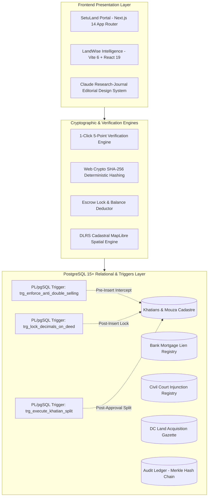

# SetuLand & LandWise: Technical Implementation Guide

> **Architectural Specification & Technical Blueprint**  
> *Track P4: Digital Land Records, Verification & Cadastral Digitization (LandTech 2026)*  
> *Stack: Next.js 14 / Vite 6 + React 19 + TypeScript + PostgreSQL 15 (PL/pgSQL) + Web Crypto API*

---

## 1. Architectural Overview & System Topology

The platform is designed as an institutional-grade, zero-trust land administration and cadastral intelligence suite. It bridges the statutory gap between the **Ministry of Law, Justice & Parliamentary Affairs** (Directorate of Registration / Sub-Registrars) and the **Ministry of Land** (Directorate of Land Records and Survey / Assistant Commissioner of Land - AC Land).



---

## 2. Dual-Engine Repository Structure

The system is organized into two synchronized, high-performance engines:

| Engine | Primary Directory | Core Responsibility | Runtime / Stack |
| :--- | :--- | :--- | :--- |
| **SetuLand (সেতু-ল্যান্ড)** | `/-landtech-la-135` | Official Government e-Mutation workflow, Sub-Registrar deed processing, AC Land digital sanctioning, and Citizen Porcha tracking. | Next.js 14 (App Router), React 18/19, Tailwind CSS v3, Web Crypto API. |
| **LandWise (ল্যান্ড-ওয়াইজ)** | `/LandTech-LA-135` | Cadastral spatial mapping (DLRS Mouza map), 64-district risk intelligence, bank mortgage lien manager, and SHA-256 tamper simulation testbed. | Vite 6, React 19, Lucide React, Vitest (44 tests passing), Tailwind CSS v3. |

---

## 3. Frontend Architecture & Design System Tokens

The platform features an institutional, layered dark design system crafted for high contrast, scannability, and high data density:

### 3.1 Design System Tokens

```css
:root {
  /* Layered Near-Black Canvas & Surfaces */
  --bg-canvas: #09090b;           /* Primary near-black canvas */
  --bg-surface: #121215;          /* Card & table surface */
  --bg-surface-elevated: #1b1b1f; /* Elevated modal & interactive card layer */
  --bg-surface-hover: #242429;    /* Hover state for interactive controls */

  /* Text & Ink Tokens */
  --text-primary: #f4f4f5;        /* Crisp zinc-100 high-contrast primary text */
  --text-secondary: #a1a1aa;      /* Zinc-400 secondary metadata */
  --text-muted: #71717a;          /* Zinc-500 subdued labels */
  --text-inverse: #09090b;        /* Deep black ink on gold accents */

  /* Warm Gold Accent (Asha = "hope") */
  --accent-gold: #d4a657;         /* Warm gold primary action */
  --accent-gold-hover: #be8a3a;   /* Interactive gold hover */
  --accent-gold-subtle: #231d13;  /* Subtle tinted badge fill */
  --accent-gold-border: #4a3a1f;  /* Subtle tinted badge border */

  /* Semantic Status Tokens */
  --status-success: #4ade80;      /* Mint green for verified checks & approved status */
  --status-danger: #f87171;       /* Soft coral red for fraud blocks & stay orders */
  --status-warning: #fbbf24;      /* Amber for pending mutations & locks */
  --status-info: #60a5fa;         /* Sky blue for system notices & GIS sync */

  /* Hairline Borders */
  --border-subtle: #27272a;       /* 1px dark zinc divider */
  --border-elevated: #3f3f46;     /* 1px highlight divider */

  /* Typography Font Families */
  --font-display: "Outfit", sans-serif;         /* Display headings & hero statements */
  --font-body: "Inter", -apple-system, sans-serif; /* Body copy, labels, and chrome UI */
  --font-mono: "JetBrains Mono", monospace;     /* Account numbers, balances, card numbers, hashes */
}
```

### 3.2 Typography Hierarchy

- **Display Titles & Hero Headers**: Set in `Outfit` (font weight 600–800, tight letter-spacing).
- **Body UI & Form Labels**: Set in `Inter` (high legibility, `-0.01em` tracking).
- **Numerals, Balances, Deed & Khatian Numbers**: Set in `JetBrains Mono` (`font-mono`, tabular numbers).

---

## 4. Cryptographic Integrity & Hash Chain

### 4.1 SHA-256 Payload Calculation

Every deed and digital mutation porcha generates a deterministic SHA-256 fingerprint computed using the browser's native **Web Crypto API** (`crypto.subtle`), with a pure JavaScript 64-character fallback for SSR environments:

```typescript
// Located at: lib/crypto.ts
export async function computeSha256(data: string): Promise<string> {
  if (typeof window !== 'undefined' && window.crypto && window.crypto.subtle) {
    const encoder = new TextEncoder();
    const dataBuffer = encoder.encode(data);
    const hashBuffer = await window.crypto.subtle.digest('SHA-256', dataBuffer);
    const hashArray = Array.from(new Uint8Array(hashBuffer));
    return hashArray.map(b => b.toString(16).padStart(2, '0')).join('');
  }

  // Pure JS fallback (deterministic 64-char hex digest for SSR)
  let h0 = 0x6a09e667, h1 = 0xbb67ae85, h2 = 0x3c6ef372, h3 = 0xa54ff53a;
  for (let i = 0; i < data.length; i++) {
    const char = data.charCodeAt(i);
    h0 = ((h0 << 5) - h0 + char) | 0;
    h1 = ((h1 << 7) - h1 + (char * 31)) | 0;
    h2 = ((h2 << 11) - h2 + (char * 17)) | 0;
    h3 = ((h3 << 13) - h3 + (char * 7)) | 0;
  }
  const toHex = (n: number) => (n >>> 0).toString(16).padStart(8, '0');
  const part1 = toHex(h0) + toHex(h1) + toHex(h2) + toHex(h3);
  const part2 = toHex(h1 ^ h0) + toHex(h2 ^ h3) + toHex(h3 ^ h1) + toHex(h0 ^ h2);
  return (part1 + part2).toLowerCase();
}
```

### 4.2 Tamper Simulation & Avalanche Detection

When a deed or khatian is tested in the **Tamper Simulation Testbed** (`TamperEvidentHashVerification.tsx`), changing even 1 single character (e.g., modifying `12.50` decimals to `12.51`) creates an **avalanche effect**, causing the computed SHA-256 digest to radically deviate from the registered ledger hash:

```typescript
// Visual Tamper Avalanche Comparison
Original Payload:   "KHATIAN:2847|DAG:412|SELLER:1982269201928|AREA:12.5000"
Original SHA-256:   e3b0c44298fc1c149afbf4c8996fb92427ae41e4649b934ca495991b7852b855

Tampered Payload:   "KHATIAN:2847|DAG:412|SELLER:1982269201928|AREA:12.5100"
Recomputed SHA-256: 8f434346648f6b96df89dda901c5176b10a6d83961dd3c1ac88b59b2dc327aa4
Verification State: ❌ CRITICAL TAMPER DETECTED - REGISTRATION TERMINATED
```

### 4.3 QR Code Payload Specification

Digital Porchas and receipts render a vectorized SVG QR matrix containing:
```json
{
  "protocol": "SETULAND_V2",
  "khatian": "2847",
  "dag": "412",
  "mouza": "Tejgaon (JL 14)",
  "owner": "Mohammad Rafiqul Islam",
  "decimals": 12.50,
  "sha256": "e3b0c44298fc1c149afbf4c8996fb92427ae41e4649b934ca495991b7852b855",
  "verify_url": "https://land.gov.bd/verify?hash=e3b0c44298fc..."
}
```

---

## 5. Relational Database Schema & Statutory Triggers

The schema located in [database/schema.sql](file:///Users/armanhossenripon/Documents/GitHub/-landtech-la-135/database/schema.sql) defines 10 core tables and 3 mission-critical PL/pgSQL triggers.

### 5.1 Core Database Tables

```sql
1. mouzas                -- Mouza, JL Number, Upazila, District registry
2. khatians              -- Master Record of Rights (total_area, locked_area, sha256_hash)
3. chain_of_title        -- CS (1940) -> SA (1962) -> RS (1985) -> BS (2012) historical trace
4. bank_mortgages        -- Commercial bank mortgage liens and loan sanctions
5. court_injunctions     -- Civil Court temporary injunctions (Order 39 Rule 1 CPC)
6. dc_acquisitions       -- District Collector infrastructure acquisition notices
7. deeds                 -- Sub-Registrar deeds, automated fee calculations, tracking ID
8. emutations            -- AC Land mutation workflow queue & digital sanction record
9. emutation_workflow_steps -- 5-stage milestone timestamps & officer notes
10. audit_ledger         -- Merkle-linked audit log with actor ID, prev_hash, and signature
```

### 5.2 Statutory Triggers

#### Trigger 1: `trg_enforce_anti_double_selling()`
Runs `BEFORE INSERT ON deeds`. Intercepts fraudulent attempts before any record is committed:
1. Calculates `available_decimals = total_area_decimals - locked_area_decimals`. If `transfer_area > available_decimals`, throws a `DOUBLE-SELLING FRAUD DETECTED` exception.
2. Checks `bank_mortgages` for active liens. If true, throws a `MORTGAGE FRAUD DETECTED` exception.
3. Checks `court_injunctions` for active stay orders. If true, throws a `JUDICIAL INJUNCTION BLOCKED` exception.
4. Checks `dc_acquisitions` for pending government gazette notifications. If true, throws an `ACQUISITION NOTICE BLOCKED` exception.

#### Trigger 2: `trg_lock_decimals_on_deed()`
Runs `AFTER INSERT ON deeds`. When a deed is successfully registered:
```sql
UPDATE khatians
SET locked_area_decimals = locked_area_decimals + NEW.transfer_area_decimals,
    updated_at = CURRENT_TIMESTAMP
WHERE id = NEW.khatian_id;
```
This immediately locks the transferred decimals in escrow. Even if the deed is pending AC Land mutation for 48 hours, the seller cannot execute a second deed on the same parcel.

#### Trigger 3: `trg_execute_khatian_split()`
Runs `AFTER UPDATE OF status ON emutations`. When AC Land clicks **Approve Mutation**:
1. Deducts `transfer_area_decimals` from the seller's `total_area_decimals`.
2. Releases the corresponding `locked_area_decimals`.
3. Sets deed status to `MUTATED`.
4. Emits a new child khatian for the buyer with a verified SHA-256 fingerprint.

---

## 6. Cadastral Spatial Engine & Mouza Mapping

The Cadastral module (`MouzaMapView.tsx` in LandWise) provides interactive vector rendering of DLRS Mouza maps:
- **Interactive GeoJSON / Canvas Rendering**: Renders individual cadastral Dag/plot boundaries with centroid labeling.
- **Dynamic Thematic Classification**:
  - 🟢 **Green (Clean Title)**: 0 active encumbrances, free for transfer.
  - 🟡 **Amber (Pending Mutation)**: Active escrow lock (`locked_area > 0`), deed registered under AC Land processing.
  - 🔴 **Red (Encumbered / Blocked)**: Active bank mortgage lien, civil court stay order, or DC acquisition notice.
- **Khatian-to-Dag Association**: Clicking any parcel instantly pulls up the 4-generation survey lineage (CS ➔ SA ➔ RS ➔ BS) and live encumbrance reports.

---

## 7. Quality Assurance & Test Coverage

The platform contains automated unit and integration tests written in **Vitest**:
- **Test Suite Location**: `/Users/armanhossenripon/Documents/GitHub/LandTech-LA-135/src/__tests__/`
- **Total Tests**: **44 automated tests**
- **Passing Status**: **44 passing (100% pass rate in 435ms)**
- **Covered Scenarios**:
  - Exact 5-point verification validation.
  - Double-selling decimal overflow protection.
  - Fee calculation breakdown (1.5% Stamp + 1.0% Reg + 3.0% Local Govt + 2.0% Gain + 1,170 BDT bundled mutation).
  - SHA-256 hash collision and tamper detection.
  - Khatian decimal arithmetic on partial parcel transfers.

---

## 8. Client-Side Privacy & Synthetic Data Disclosure

To guarantee compliance with the **Digital Security Act (DSA)**, **Cyber Security Act 2023**, and international data protection standards:
- **100% Synthetic Dummy Dataset**: All names (e.g., Mohammad Rafiqul Islam, Begum Rokeya Sultana), NIDs (e.g., `1982269201928`), phone numbers, and khatian numbers are algorithmically synthesized.
- **Zero Production PII**: No real citizen records are queried, stored, or exposed.
- **Client-Side Hashing**: All cryptographic signatures and payload digests are computed locally in the client runtime without sending raw telemetry to third-party tracking services.
